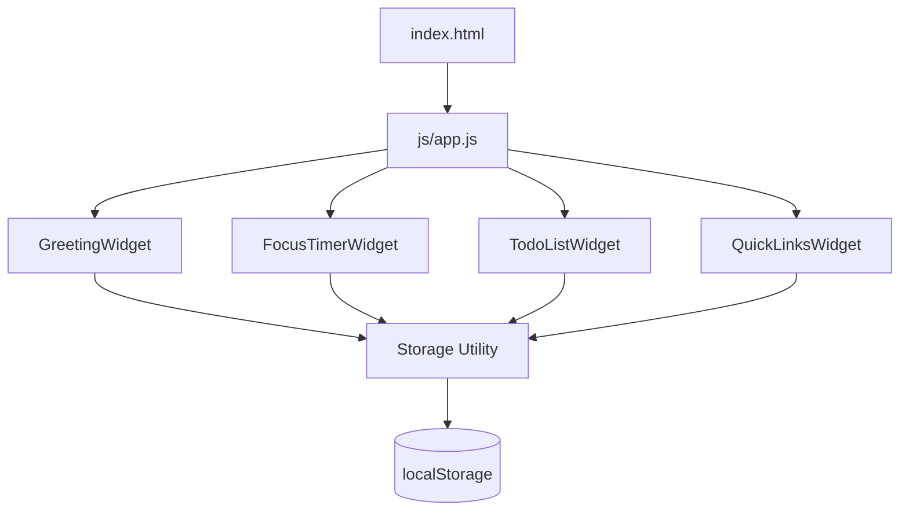

# Design Document

## Overview

The To-Do List Life Dashboard is a fully client-side, single-page web application built with plain HTML, CSS, and Vanilla JavaScript. It packages four productivity widgets into one page: a live Greeting Widget, a Pomodoro-style Focus Timer, a persistent To-Do List, and a Quick Links panel. There is no build step, no external dependencies, and no backend — the application loads from two files (`index.html` + `js/app.js` + `css/style.css`) and persists all user data to the browser's `localStorage` API.

The design goal is simplicity: one HTML file, one JS file, one CSS file, zero network requests at runtime. Every widget is self-contained in its own JavaScript module pattern (a plain object or IIFE), communicating only through the shared `Storage` utility and the DOM.

---

## Architecture

The application follows a **widget-oriented flat architecture** — no framework, no virtual DOM, no module bundler. Each widget owns its own DOM subtree, event listeners, and state. A tiny shared utilities layer handles `localStorage` access and ID generation.



**Startup sequence:**

1. Browser parses `index.html` and loads `css/style.css` and `js/app.js`.
2. `app.js` registers a `DOMContentLoaded` listener.
3. On load, each widget's `init()` function is called in order.
4. Widgets read their persisted data from `localStorage`, render their initial state, and attach event listeners.
5. The Greeting Widget starts a `setInterval` tick at 1 Hz.
6. The application is fully interactive — no further network activity occurs.

**Data flow:**

```
User Action → DOM Event → Widget Handler → [State Mutation] → Re-render DOM subtree → Storage.save()
```

Widgets never communicate with each other. There is no global state object — each widget holds its own in-memory state array/object.

---

## Components and Interfaces

### Shared Utilities (`StorageUtil`, `generateId`)

```js
// StorageUtil — wraps localStorage with try/catch
StorageUtil = {
  load(key)          // returns parsed JSON or null; swallows parse errors
  save(key, value)   // serializes to JSON; returns true on success, false on failure
}

// generateId — returns a collision-resistant string ID
generateId()         // uses crypto.randomUUID() with Date.now() fallback
```

`StorageUtil.load` returns `null` on any error (missing key, malformed JSON, unavailable storage). Callers treat `null` as "no saved data". `StorageUtil.save` returns a boolean — callers display an error message when `false` is returned.

---

### GreetingWidget

**Responsibilities:** Display the current time (HH:MM:SS), date (DayName, MonthName DD, YYYY), and a time-based greeting. Update every second via `setInterval`.

**Interface:**

```js
GreetingWidget = {
  init()     // reads DOM refs, starts 1 Hz interval, calls render()
  render()   // reads new Date(), updates #greeting-time, #greeting-date, #greeting-message
  _getGreeting(hour)  // pure function: number → string
}
```

**Greeting logic (`_getGreeting`):**

| Hour range (0–23) | Message |
|---|---|
| 5 – 11 | "Good Morning" |
| 12 – 17 | "Good Afternoon" |
| 18 – 21 | "Good Evening" |
| 22 – 23, 0 – 4 | "Good Night" |

If `new Date()` throws, the widget catches the error and renders the fallback state: "Hello" with no time/date elements.

**DOM elements:**

- `#greeting-message` — h1-level greeting text
- `#greeting-time` — `<time>` element for HH:MM:SS
- `#greeting-date` — `<p>` for formatted date

---

### ThemeWidget

**Responsibilities:** Apply a light or dark color scheme across the entire page. Persist the chosen theme to `localStorage["todo-life-dashboard-theme"]`. Restore the saved theme on load.

**Interface:**

```js
ThemeWidget = {
  init()             // reads saved theme from storage (default "light"), calls _apply(), attaches toggle listener
  _toggle()          // reads current theme from <html data-theme>, flips to opposite, calls _apply() + _save()
  _apply(theme)      // sets document.documentElement.setAttribute("data-theme", theme); updates toggle button label/icon
  _save(theme)       // calls StorageUtil.save("todo-life-dashboard-theme", theme); silent on failure (Req 11.6)
}
```

**CSS approach — custom properties on `data-theme`:**

```css
:root, [data-theme="light"] {
  --color-bg:      #f0f2f5;
  --color-surface: #ffffff;
  --color-text:    #1a1a2e;
  /* … more tokens … */
}

[data-theme="dark"] {
  --color-bg:      #1a1a2e;
  --color-surface: #2c3e50;
  --color-text:    #ecf0f1;
  /* … more tokens … */
}
```

All existing color declarations in `style.css` are replaced with `var(--color-*)` references so the theme switch takes effect without any additional JS class manipulation.

**DOM elements:**

- `#theme-toggle` — a `<button>` in a persistent header/top-bar area visible above the `.dashboard` grid; label or `aria-label` updated to reflect the currently active theme ("Switch to dark mode" / "Switch to light mode").

**State:** theme name string — either `"light"` or `"dark"`. No other in-memory state is needed; the current theme is always read from `document.documentElement.dataset.theme`.

---

### UserNameWidget

**Responsibilities:** Let the user set a personal name that is prefixed to the time-based greeting. Persist the name to `localStorage["todo-life-dashboard-name"]`. Integrate with `GreetingWidget.render()` so every clock tick uses the current name.

**Interface:**

```js
UserNameWidget = {
  init()           // reads saved name from storage, calls _render(), attaches button listeners
  _setName(raw)    // trims raw; if empty treats as clear; else persists and re-renders
  _clearName()     // removes name from storage, clears in-memory name, calls _render()
  _save(name)      // StorageUtil.save("todo-life-dashboard-name", name); silent on failure (Req 12.8)
  _render()        // updates #name-display (shows name or placeholder); hides/shows edit UI
}
```

**Greeting integration:** `GreetingWidget._getGreeting(hour)` returns the base phrase. `GreetingWidget.render()` appends `, {name}` when `UserNameWidget` has a non-empty name set, producing e.g. "Good Morning, Alice".

**DOM elements (inside `#greeting-widget`):**

- `#name-display` — `<span>` showing the current name (or empty when none set)
- `#name-edit-btn` — opens the inline name-edit form
- `#name-input` — text input for entering/changing the name
- `#name-save-btn` — saves the typed name
- `#name-clear-btn` — clears the saved name

**Validation:** Whitespace-only input is treated as a clear action (Requirement 12.7); no separate error message is shown.

---

### FocusTimerWidget

**Responsibilities:** 25-minute Pomodoro countdown. Start/stop/reset controls. Display remaining time in MM:SS. Show session-end message at 00:00.

**Interface:**

```js
FocusTimerWidget = {
  init()              // sets initial state, grabs DOM refs, attaches button listeners
  _start()            // starts setInterval (1 Hz tick) if not running and time > 0
  _stop()             // clears interval, sets running = false
  _reset()            // calls _stop(), restores totalSeconds = 1500, re-renders
  _tick()             // decrements totalSeconds; calls _stop() + _showEndMessage() at 0
  _render()           // updates #timer-display with MM:SS formatted string
  _showEndMessage()   // makes #timer-end-message visible
  _hideEndMessage()   // hides #timer-end-message
}
```

**State:**

```js
{ totalSeconds: 1500, running: false, intervalId: null }
```

**Key rules:**

- Start is a no-op if `running === true` or `totalSeconds === 0`.
- If `totalSeconds === 0` when Start is pressed, the widget resets to 1500 before starting (Requirement 2.7).
- Reset always clears any active interval before setting `totalSeconds = 1500`.

**DOM elements:**

- `#timer-display` — shows MM:SS countdown
- `#timer-start`, `#timer-stop`, `#timer-reset` — control buttons
- `#timer-end-message` — hidden by default; shown when countdown reaches 00:00

---

### TodoListWidget

**Responsibilities:** Add, edit, complete, and delete tasks. Persist to `localStorage["todo-life-dashboard-tasks"]`. Show error messages for invalid input or storage failures.

**Interface:**

```js
TodoListWidget = {
  init()                    // loads tasks from storage, renders list, attaches form listener
  _addTask(description)     // validates, creates Task, pushes to _tasks, saves, re-renders
  _editTask(id, newDesc)    // validates, mutates Task in _tasks, saves, re-renders
  _toggleTask(id)           // flips Task.complete, saves, re-renders
  _deleteTask(id)           // removes Task from _tasks, saves, re-renders
  _isDuplicate(description, excludeId)  // returns true if any other task matches description case-insensitively
  _save()                   // calls StorageUtil.save; shows error message on false return
  _render()                 // rebuilds #todo-list ul from _tasks array
  _renderTask(task)         // returns a <li> element for one Task
  _showInputError(msg)      // displays validation error near input
  _clearInputError()        // hides validation error
}
```

**In-memory state:** `_tasks` — array of `Task` objects (see Data Models).

**Validation rules:**

- Description must be non-empty after `.trim()`.
- Description must be ≤ 500 characters.
- Empty/whitespace-only input → show error, do not add/edit.
- Duplicate description (case-insensitive, trimmed) → show error "A task with this description already exists.", do not add/edit.

**Duplicate detection:**

```js
_isDuplicate(description, excludeId)
// Returns true if any task in _tasks (excluding the task with excludeId, if provided)
// has description.trim().toLowerCase() === input.trim().toLowerCase().
// Called in _addTask with no excludeId, and in _editTask with excludeId = current task's id.
```

**DOM elements:**

- `#todo-input` — text input for new task
- `#todo-add-btn` — submit button (also supports Enter key)
- `#todo-input-error` — inline error message span
- `#todo-list` — `<ul>` container for task items
- Each `<li>` contains: checkbox (toggle), description `<span>` or edit `<input>`, edit button, save-edit button, cancel-edit button, delete button.

**Edit mode:** When a task enters edit mode, its `<span>` is replaced with an `<input>` pre-filled with the current description. Save/cancel buttons replace the edit button. Other tasks remain unaffected.

---

### QuickLinksWidget

**Responsibilities:** Display saved links as clickable buttons (open in new tab). Add links (label + URL). Delete links. Persist to `localStorage["todo-life-dashboard-links"]`.

**Interface:**

```js
QuickLinksWidget = {
  init()                  // loads links from storage, renders, attaches form listener
  _addLink(label, url)    // validates, creates Link, pushes to _links, saves, re-renders
  _deleteLink(id)         // removes Link from _links, saves, re-renders
  _save()                 // StorageUtil.save; shows error on failure
  _render()               // rebuilds #links-list from _links array
  _renderLink(link)       // returns a container element for one Link
  _showFormError(msg)     // displays validation error near the form
  _clearFormError()       // hides the form error
}
```

**In-memory state:** `_links` — array of `Link` objects (see Data Models).

**Validation rules:**

- Label must be non-empty after `.trim()`.
- URL must be non-empty and start with `http://` or `https://`.
- Specific error message per failing field (Requirement 8.3).

**DOM elements:**

- `#link-label-input`, `#link-url-input` — form inputs
- `#link-add-btn` — submit button
- `#link-form-error` — inline error message span
- `#links-list` — container div for link items
- Each link item: `<a target="_blank">` with label text + delete button

---

## Data Models

### Task

```js
{
  id:          string,   // unique identifier (crypto.randomUUID or Date.now fallback)
  description: string,   // 1–500 characters, trimmed
  complete:    boolean   // false = incomplete, true = complete
}
```

Stored as a JSON array under `localStorage["todo-life-dashboard-tasks"]`.

### Link

```js
{
  id:    string,   // unique identifier (same generation strategy as Task)
  label: string,   // non-empty, trimmed
  url:   string    // starts with "http://" or "https://"
}
```

Stored as a JSON array under `localStorage["todo-life-dashboard-links"]`.

### StorageUtil contract

- `StorageUtil.load("todo-life-dashboard-tasks")` → `Task[]` | `null`
- `StorageUtil.load("todo-life-dashboard-links")` → `Link[]` | `null`
- `null` return means: no saved data, or malformed JSON, or storage unavailable — all treated as empty list.
- `StorageUtil.save(key, array)` → `boolean` — `false` means storage write failed.

### Serialization invariant

When a task/link collection is written to JSON and read back, each item must reconstruct with identical `id`, `description`/`label`/`url`, and `complete` (for tasks). `JSON.stringify` → `JSON.parse` is the sole serialization mechanism; no custom encoding.

---

## Correctness Properties

*A property is a characteristic or behavior that should hold true across all valid executions of a system — essentially, a formal statement about what the system should do. Properties serve as the bridge between human-readable specifications and machine-verifiable correctness guarantees.*

### Property 1: Greeting classification covers all hours

*For any* integer hour in [0, 23], `_getGreeting(hour)` SHALL return exactly one of "Good Morning", "Good Afternoon", "Good Evening", or "Good Night", and the returned value SHALL be consistent with the hour ranges defined in Requirement 1.

**Validates: Requirements 1.3, 1.4, 1.5, 1.6**

---

### Property 2: Task serialization round-trip

*For any* array of Task objects (each with a valid `id`, `description`, and `complete` field), serializing the array with `JSON.stringify` and deserializing it with `JSON.parse` SHALL produce an array containing the same number of tasks, where each task has the same `id`, `description`, and `complete` value as the corresponding original task.

**Validates: Requirements 6.3**

---

### Property 3: Adding a valid task grows the list by one

*For any* task list state and any non-empty, non-whitespace description of at most 500 characters, calling `_addTask` SHALL result in the task list length increasing by exactly one, and the new task SHALL have `complete = false` and a description equal to the trimmed input.

**Validates: Requirements 3.2, 3.5**

---

### Property 4: Whitespace-only and empty descriptions are always rejected

*For any* string composed entirely of whitespace characters (including the empty string), calling `_addTask` or `_editTask` with that string SHALL leave the task list unchanged and SHALL not persist any new data.

**Validates: Requirements 3.4, 4.5**

---

### Property 5: Completion toggle is its own inverse

*For any* task in any state, toggling its completion state twice SHALL return the task to its original `complete` value (i.e., `toggle(toggle(task.complete)) === task.complete`).

**Validates: Requirements 5.2, 5.3**

---

### Property 6: Deleted task is absent from the list

*For any* task list containing a task with a given `id`, calling `_deleteTask(id)` SHALL result in a list that contains no task with that `id`.

**Validates: Requirements 5.6**

---

### Property 7: Link serialization round-trip

*For any* array of Link objects (each with a valid `id`, `label`, and `url`), serializing and deserializing SHALL produce an array with the same number of links, where each link has the same `label` and `url` as the original.

**Validates: Requirements 8.6**

---

### Property 8: Invalid link submissions are always rejected

*For any* submission where the label is empty/whitespace-only, or the URL does not begin with `http://` or `https://`, `_addLink` SHALL leave the link list unchanged and SHALL not write to `localStorage`.

**Validates: Requirements 8.3**

---

### Property 9: Timer format is always valid MM:SS

*For any* integer `totalSeconds` in [0, 1500], the formatted timer string SHALL match the pattern `MM:SS` where MM is zero-padded minutes (00–25) and SS is zero-padded seconds (00–59).

**Validates: Requirements 2.3**

---

### Property 10: No duplicate task descriptions

*For any* task list state and any trimmed, case-insensitive description that already exists in the list, calling `_addTask` or `_editTask` (on a different task) with that description SHALL leave the task list unchanged and SHALL display the error message "A task with this description already exists."

**Validates: Requirements 3.7, 4.7**

---

### Property 11: Theme persists across simulated loads

*For any* theme value in `{"light", "dark"}`, applying that theme and then reading it back from `localStorage["todo-life-dashboard-theme"]` SHALL return the same theme value, and calling `ThemeWidget.init()` with that stored value SHALL result in `document.documentElement.dataset.theme` equaling the stored value.

**Validates: Requirements 11.3, 11.4**

---

## Error Handling

| Scenario | Widget | Behavior |
|---|---|---|
| Empty/whitespace task input | TodoListWidget | Show `#todo-input-error`; no state change |
| Task description > 500 chars | TodoListWidget | Show `#todo-input-error`; no state change |
| Duplicate task description (add or edit) | TodoListWidget | Show `#todo-input-error` / inline edit error with "A task with this description already exists."; no state change |
| Empty/whitespace edit input | TodoListWidget | Show inline error on edit input; retain original description |
| `localStorage` write failure (add/edit/toggle/delete task) | TodoListWidget | Apply state change in memory; display persistent error message |
| `localStorage` write failure (add/delete link) | QuickLinksWidget | Apply state change in memory; display persistent error message |
| Empty label or invalid URL on link add | QuickLinksWidget | Show `#link-form-error` identifying which field failed; no state change |
| Malformed JSON in `localStorage` on load | StorageUtil | Return `null`; widget treats as empty list; no crash |
| `localStorage` unavailable on load | StorageUtil | Return `null`; widget treats as empty list; no crash |
| `new Date()` throws (Greeting) | GreetingWidget | Display "Hello"; omit time and date elements |
| Timer at 00:00, Start pressed | FocusTimerWidget | Reset to 25:00 and start fresh countdown |
| `localStorage` write failure (theme toggle) | ThemeWidget | Apply theme in-memory for current session; no error displayed (Req 11.6) |
| `localStorage` write failure (save name) | UserNameWidget | Apply name in-memory for current session; no error displayed (Req 12.8) |
| Whitespace-only User_Name submitted | UserNameWidget | Treat as clear action; revert to generic greeting; no error message |

All error messages are displayed inline near the relevant control — no modal dialogs, no `alert()`. Error messages are cleared when the user retries the action successfully.

---

## Testing Strategy

### Dual Testing Approach

Both unit tests and property-based tests are used. Unit tests verify specific concrete scenarios and edge cases. Property-based tests verify universal invariants across large randomized input spaces.

### Property-Based Testing

The feature involves pure functions (greeting classification, task/link serialization, timer formatting, input validation) that are well-suited to property-based testing. The recommended library is **[fast-check](https://github.com/dubzzz/fast-check)** for JavaScript.

Each property-based test runs a **minimum of 100 iterations** with randomized inputs. Each test is tagged with a comment in the form:

```
// Feature: todo-life-dashboard, Property N: <property_text>
```

**Properties to implement as PBT:**

| Property | Test description |
|---|---|
| Property 1 | Generate all 24 hour values; assert `_getGreeting` returns the correct string |
| Property 2 | Generate random Task arrays; assert `JSON.parse(JSON.stringify(tasks))` deep-equals original |
| Property 3 | Generate valid descriptions; assert list length +1 and correct task fields |
| Property 4 | Generate whitespace-only strings; assert no state change |
| Property 5 | Generate tasks with random `complete` values; assert double-toggle restores original |
| Property 6 | Generate task lists with a known id; assert id absent after delete |
| Property 7 | Generate random Link arrays; assert round-trip equality |
| Property 8 | Generate invalid label/URL combos; assert link list unchanged |
| Property 9 | Generate integers 0–1500; assert formatted string matches `/^\d{2}:\d{2}$/` with correct values |
| Property 10 | Generate task lists with existing descriptions; assert `_addTask`/`_editTask` with duplicate is rejected and list unchanged |
| Property 11 | Generate theme values `"light"` and `"dark"`; assert `StorageUtil.save` + `StorageUtil.load` round-trip returns same value; assert `ThemeWidget.init()` sets `data-theme` accordingly |

### Unit Tests

Unit tests cover:

- **GreetingWidget**: Correct date format string for a known `Date` value; fallback "Hello" state when `Date` throws.
- **FocusTimerWidget**: Start → tick → stop sequence; reset from mid-count; start at 00:00 resets to 25:00; end message visibility at 00:00.
- **TodoListWidget**: Add task renders new `<li>`; edit task updates description; delete removes `<li>`; completed task has strikethrough; storage failure shows error message.
- **QuickLinksWidget**: Add link renders anchor; clicking anchor has `target="_blank"`; delete removes link; storage failure shows error.
- **StorageUtil**: `load` returns `null` for malformed JSON; `save` returns `false` when storage is full (mock `localStorage.setItem` to throw).

### Integration Tests

- Full `init()` → render cycle with a pre-seeded `localStorage` value verifies all four widgets read and display saved data on load.
- Empty `localStorage` verifies all four widgets render without errors or visible artifacts.

### Accessibility Checklist (manual)

- All interactive controls have accessible labels (`aria-label` or associated `<label>`).
- Error messages are associated with their inputs via `aria-describedby` or `role="alert"`.
- Color is not the sole visual indicator for task completion (strikethrough text is also required).
- Focus management: after adding/editing/deleting a task or link, focus returns to the relevant input field.
